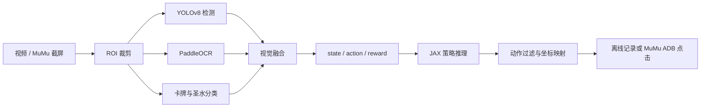

# KataCR LiveLoop

**中文** | [English](README_en.md)

基于 [wty-yy/KataCR](https://github.com/wty-yy/KataCR) 的个人工程适配线：把原项目的视觉感知与离线策略推理，整理为适用于 **WSL2 + NVIDIA GPU + MuMu 模拟器** 的可复现运行链路。

> 这是一个基于上游 KataCR 的 Fork/适配项目。原始决策模型、训练数据、核心研究架构和主要算法设计归属于上游作者；本仓库重点记录本人的运行时适配、工程集成、性能优化、诊断工具和 MuMu 实时闭环实践。

## 链路

详细模块图见 [`docs/architecture.md`](docs/architecture.md)。

工程同时保留两种入口：

- **离线评估**：输入对局视频，检查感知、状态构建、策略输出和动作记录。
- **MuMu 实时实验**：通过 ADB 获取模拟器画面，经过页面状态识别后执行训练营/娱乐模式动作。

## 本适配线的主要工作

- 在 WSL2 + Python 3.11 环境中打通 JAX GPU、YOLO GPU 和 Paddle/PaddleOCR GPU 运行路径，并保留 CPU 回退。
- 为离线评估增加视频路径、输出目录、保存/显示、确定性和详细日志等运行参数。
- 处理 CUDA 编译工具、JAX checkpoint/Orbax 跨设备恢复和辅助权重缺失等部署问题。
- 将 ROI 裁剪、卡牌识别、OCR、圣水与战场状态融合接入统一的诊断流程，并补充关键帧与回放导出工具。
- 增加 MuMu ADB 截屏、页面状态识别、训练营流程和动作坐标映射的实验链路。
- 针对模拟器比例、窗口偏移、动作节流和识别抖动补充配置与日志，便于复现问题。
- 提供 Windows 启动脚本和 WSL 运行脚本，降低从环境验证到实际测试的启动成本。

完整的作者贡献边界见 [`docs/contributions.md`](docs/contributions.md)。

## 当前状态

- 视频输入、感知融合、策略推理和结果落盘链路已可运行。
- MuMu ADB 基础通路和训练营实战动作链路已验证，可完成有限的自动下牌实验。
- 当前重点仍是识别稳定性、动作时序、坐标适配和策略模型实际发挥程度，不把单局胜负当成模型能力的充分证明。
- 线上对战、天梯模式和长期无人值守运行不属于当前承诺范围。请先使用训练营或其他低风险测试模式。

## 运行环境

- Windows 侧运行 MuMu 模拟器并开启 ADB 调试。
- WSL2 + Ubuntu 24.04。
- Python 3.11 独立虚拟环境。
- NVIDIA GPU；JAX、YOLO 和 Paddle/PaddleOCR 的 CUDA 版本应与本机驱动匹配。

不要把个人绝对路径、模型权重、视频、日志或账号信息提交到仓库。建议通过环境变量或命令行参数传入路径。

## 入口与文档

- [公开运行说明](docs/windows_launch_public_zh-CN.md)
- [贡献边界](docs/contributions.md)
- [架构图](docs/architecture.md)
- [English contribution boundary](docs/contributions_en.md)

本地实验脚本包括离线评估、GPU 验证、ADB 探测、关键帧导出和回放生成。执行前请阅读脚本顶部参数和对应文档，并确认当前模拟器处于安全测试模式。

## 上游项目与致谢

- 原始项目：[wty-yy/KataCR](https://github.com/wty-yy/KataCR)
- 原始目标检测数据集：[Clash-Royale-Detection-Dataset](https://github.com/wty-yy/Clash-Royale-Detection-Dataset)
- 原始回放数据集：[Clash-Royale-Replay-Dataset](https://github.com/wty-yy/Clash-Royale-Replay-Dataset)
- 上游项目历史记录：[`UPDATE_LOGS.md`](UPDATE_LOGS.md)

本项目遵循上游 MIT License。上游代码、模型、数据集和展示结果应按各自许可证及原作者说明使用；本仓库新增的工程代码和文档由 `hero7014` 维护，具体边界以 [`docs/contributions.md`](docs/contributions.md) 为准。
