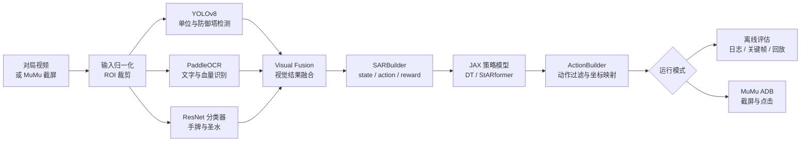
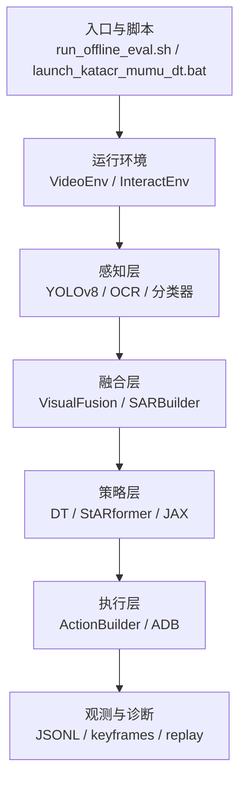
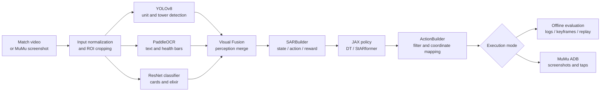

# KataCR LiveLoop Architecture

[中文](architecture.md) | [English](architecture_en.md)

## 中文

### 运行链路

### 代码分层

## English

### Runtime flow

The same modules support two entry points: recorded-video evaluation and a MuMu ADB experiment loop. The policy is inherited from KataCR; this repository concentrates on runtime integration, diagnostics, and reproducibility.
