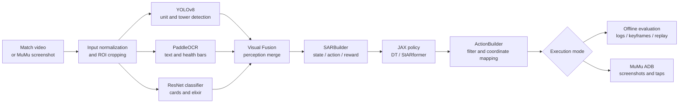
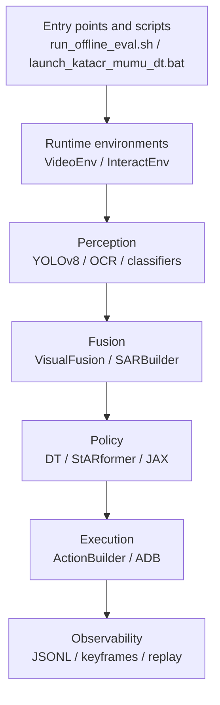

# KataCR LiveLoop Architecture

[中文](architecture.md) | [English](architecture_en.md)

## Runtime flow

## Module layers

The project has two practical paths:

1. Recorded video enters the perception and policy stack, producing frame-level actions and analysis artifacts.
2. MuMu provides screenshots over ADB; the same perception and policy stack produces filtered screen actions for low-risk experiments.

The inherited policy model remains separate from the runtime work added in this adaptation. See [`docs/contributions_en.md`](contributions_en.md) for the attribution boundary.
